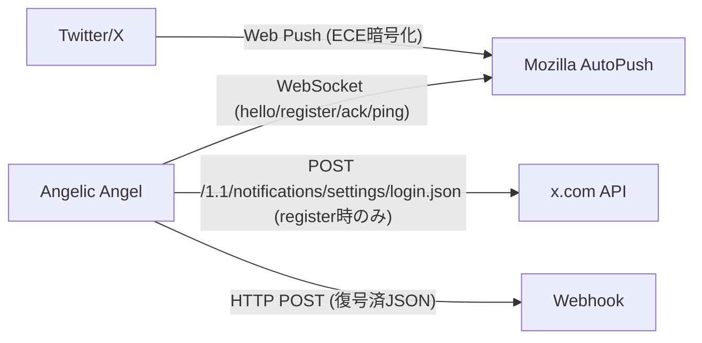
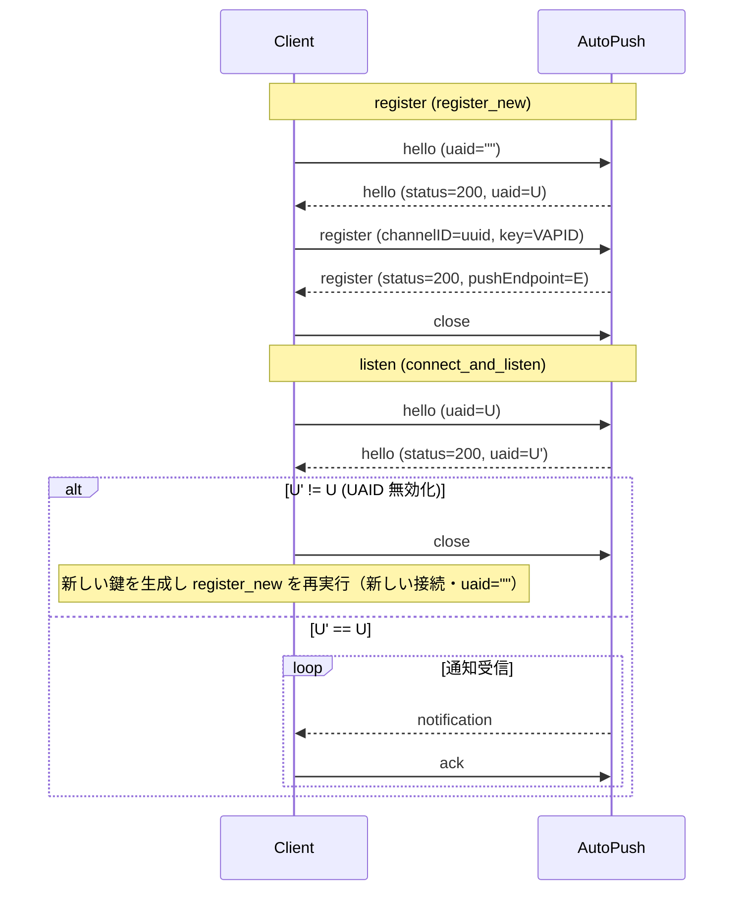
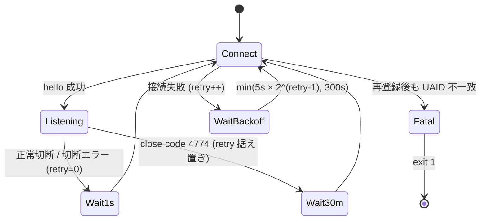
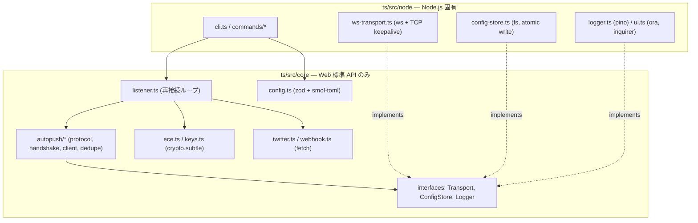
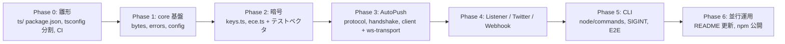

# Design Doc: Angelic Angel の TypeScript 移植

| 項目 | 内容 |
|---|---|
| 対象 | `angelic-angel` v0.1.0 (Rust, edition 2024, 計 約1,800行) |
| 移植先 | TypeScript（`ts/` ディレクトリ） |
| ステータス | **Approved**（全項目決定済み） |
| 作成日 | 2026-10-05 |

### 決定事項ログ

| # | 論点 | 決定 |
|---|---|---|
| D1 | 暗号処理 | **Web Crypto API (`crypto.subtle`) で ECE 復号・鍵生成を自前実装**する。`node:crypto` / `http_ece` はランタイム依存にしない（§5.4、PoC で検証済み） |
| D2 | 現行実装の癖への対応 | §7 の修正案をすべて採用 |
| D3 | Ctrl-C 時の exit code | **130** に変更 |
| D4 | リポジトリ構成 | 同一リポジトリに **`ts/`** を作成し、Rust 版と並行運用する |
| D5 | Web 標準志向 | ロジック層 (`ts/src/core`) は Web 標準 API のみで実装し、Node 固有 API はプラットフォーム層 (`ts/src/node`) に閉じ込める（§3.1） |
| D6 | Twitter API の User-Agent | **Firefox の User-Agent に揃える**（AutoPush 接続時と同じ UA を明示付与しブラウザに擬態） |

---

## 1. 背景と目的

Angelic Angel は、ブラウザ (Firefox) の Web Push クライアントをエミュレートして Mozilla AutoPush (`wss://push.services.mozilla.com/`) に接続し、Twitter/X からのプッシュ通知を受信・ECE 復号して Webhook に転送する CLI です。

本ドキュメントは、この Rust 実装を **TypeScript** に移植するための設計を定めます。

### 1.1 Goals

- 既存 CLI と **同じコマンド体系・同じ挙動**（プロトコル、タイマー、再接続戦略、ACK コード）を再現する（§7 の意図的な変更を除く）
- 既存の設定ファイル `angelic-angel.toml` と **相互互換**（Rust 版で作った設定を TS 版でそのまま `listen` できる。逆も可）
- **可能な限り Web 標準 API で実装**し、ランタイム固有の部分を最小化する
- Rust 版で文字列マッチングに依存している箇所などを、型安全な設計に置き換える
- 単体テスト・結合テスト（モック AutoPush サーバ）で挙動の同等性を担保する

### 1.2 Non-Goals

- 新機能の追加（複数 Webhook、通知フィルタ、Twitter 側の購読解除 API 呼び出し等）
- ブラウザ / Edge ランタイム (Cloudflare Workers 等) で **CLI 全体を** 動かすこと
  - TCP keepalive の設定や WebSocket Ping フレームの送信は Web 標準の `WebSocket` ではできないため、トランスポートは Node 実装とする。ただし core 層は他ランタイムでも再利用できる構造にする
- Rust 版の廃止判断（並行運用後に別途判断）

---

## 2. 現行実装の解析

### 2.1 全体アーキテクチャ



### 2.2 モジュール構成

| ファイル | 行数 | 役割 |
|---|---|---|
| [main.rs](../src/main.rs) | 261 | エントリポイント。ログ初期化、Ctrl-C 処理、各サブコマンド実装 (`cmd_*`)、スピナー UI |
| [cli.rs](../src/cli.rs) | 42 | clap による CLI 定義 |
| [config.rs](../src/config.rs) | 58 | TOML 設定の型と load/save、`WEBHOOK_ENDPOINT` 取得 |
| [error.rs](../src/error.rs) | 40 | `AngelicAngelError` (thiserror) |
| [autopush.rs](../src/autopush.rs) | 846 | AutoPush WebSocket プロトコル実装。接続、hello/register/unregister、通知受信ループ、ping/pong、重複排除、ACK |
| [listener.rs](../src/listener.rs) | 382 | 再接続ループ、UAID 無効化時の再登録、ECE 復号、Webhook 送信 |
| [push.rs](../src/push.rs) | 54 | P-256 鍵ペア・auth secret 生成、`subscribe()` |
| [twitter.rs](../src/twitter.rs) | 84 | Twitter のプッシュ購読登録 API 呼び出し |

### 2.3 CLI 仕様

```
angelic-angel [-c|--config <PATH>] [-v|--verbose] <COMMAND>
```

| オプション | デフォルト | 説明 |
|---|---|---|
| `-c, --config` | `angelic-angel.toml` (カレントディレクトリ相対) | 設定ファイルパス |
| `-v, --verbose` | false | ログレベルを `debug` に（未指定時は `warn`） |

| コマンド | 処理 |
|---|---|
| `init [--auth-token X] [--ct0 Y]` | 未指定の値は対話入力（`auth_token` はパスワード入力、`ct0` は通常入力）。`registration` なしで設定を**上書き保存** |
| `register` | 鍵生成 → AutoPush 新規登録 → Twitter API 登録 → `registration` を保存 |
| `listen` | `registration` 必須。無限再接続ループで通知を受信し Webhook へ転送 |
| `status` | 設定の要約表示（`auth_token`/`ct0` は先頭20文字、endpoint は先頭50文字）。設定が読めなくてもエラー終了しない |
| `unregister` | AutoPush に unregister を送信し、`registration` を削除して保存（Twitter API は呼ばない） |

**プロセス挙動（Rust 版）**

- Ctrl-C: どのコマンド実行中でも `Interrupted` を赤字表示して exit code 0 で終了（TS 版では 130 に変更: D3）
- エラー: `error: <message>` を stderr に出して **exit code 1**
- UI 出力（見出し・スピナー・結果）は **stderr**、`tracing` のログは **stdout**（`tracing_subscriber::fmt()` のデフォルト）

### 2.4 設定ファイル形式

```toml
[twitter]
auth_token = "..."
ct0 = "..."

[registration]            # register 前は存在しない (Option::None は省略される)
endpoint = "https://updates.push.services.mozilla.com/wpush/v2/..."

[registration.autopush]
uaid = "..."
channel_id = "xxxxxxxx-xxxx-4xxx-xxxx-xxxxxxxxxxxx"

[registration.keys]
public_key  = [4, 94, 104, ...]   # Vec<u8> → 整数配列 (65 bytes, SEC1 非圧縮)
private_key = [12, 200, ...]      # 32 bytes 生スカラー
auth_secret = [1, 2, ...]         # 16 bytes
```

> [!IMPORTANT]
> 鍵は base64 文字列ではなく **整数配列** で保存されている（serde の `Vec<u8>` デフォルト表現）。互換性のため TS 版も同形式で読み書きする必要がある。

`WEBHOOK_ENDPOINT` は設定ファイルではなく環境変数から、**通知を受信するたびに**読み込まれる。

### 2.5 AutoPush プロトコル

#### 接続 (`connect_ws`)

- URL: `wss://push.services.mozilla.com/`
- ヘッダ: `User-Agent: Mozilla/5.0 (Macintosh; Intel Mac OS X 10.15; rv:134.0) Gecko/20100101 Firefox/134.0`、`Origin: https://x.com`
- TCP: keepalive 60秒、`TCP_NODELAY = true`
- TLS: rustls + webpki-roots

#### メッセージ (JSON, `messageType` タグ)

送信 (Client → Server):

```jsonc
{"messageType":"hello","uaid":"","use_webpush":true,"broadcasts":{}}   // 新規。再接続時は uaid に既存値。channelIDs は送らない
{"messageType":"register","channelID":"<uuid v4>","key":"<VAPID公開鍵 base64url>"}
{"messageType":"unregister","channelID":"<uuid>","code":200}
{"messageType":"ack","updates":[{"channelID":"...","version":"...","code":100}]}
{}                                                                      // アプリケーションレベル ping
```

受信 (Server → Client):

```jsonc
{"messageType":"hello","status":200,"uaid":"...","use_webpush":true,"broadcasts":{}}
{"messageType":"register","status":200,"pushEndpoint":"...","channelID":"..."}
{"messageType":"notification","channelID":"...","version":"...","data":"<base64url>","headers":{"encoding":"aes128gcm", ...}}
{}  // または messageType を持たない任意の JSON オブジェクト → pong とみなす (is_pong)
```

Twitter の VAPID 公開鍵（`applicationServerKey`、65 bytes）:

```
BF5oEo0xDUpgylKDTlsd8pZmxQA1leYINiY-rSscWYK_3tWAkz4VMbtf1MLE_Yyd6iII6o-e3Q9TCN5vZMzVMEs
```

#### ACK コード

| コード | 意味 | 送信条件 |
|---|---|---|
| 100 | Delivered | 復号・Webhook 送信成功 / `data` なし / 重複通知 |
| 101 | DecryptionError | `AngelicAngelError::Decryption`（base64 失敗、ECE 失敗、UTF-8 失敗、未対応 encoding） |
| 102 | NotDelivered | それ以外のエラー（`WEBHOOK_ENDPOINT` 未設定、Webhook への HTTP 通信失敗など） |

> [!NOTE]
> Webhook が **非 2xx を返しても** ログを出すだけで成功扱い (ACK 100) になる。

#### シーケンス



各レスポンス待ちのタイムアウトは **10 秒**。期待と異なる `messageType` / テキスト以外のフレーム / 切断 / タイムアウトはすべてエラー。

### 2.6 受信ループのタイマー (`AutoPushClient::next_notification`)

| タイマー | 値 | 動作 |
|---|---|---|
| アプリ ping | 5 分 | 無受信が続いたらテキスト `{}` を送り、pong 待ちへ |
| pong タイムアウト | 10 秒 | pong が来なければエラー（再接続） |
| WS Ping フレーム | 150 秒 | RFC 6455 の Ping フレームを送信（L7 LB 対策） |

- **任意のメッセージ受信で両タイマーをリセット**
- `next_notification()` 呼び出しごとにタイマーは初期化される（＝通知処理中の時間はカウントされない）
- pong 待ち中 (`wait_for_pong_or_notification`) に通知が来た場合はその通知を返す（pong 待ちは打ち切り）
- 受信した WS Ping には Pong を返す
- Close フレームの code が **4774** なら `"BACKOFF: ..."` エラー、それ以外は `Ok(None)`（正常切断）
- **重複排除**: 直近 100 件の `version` を `VecDeque` + `HashSet` で保持。重複は ACK 100 を返して読み飛ばす

### 2.7 再接続戦略 (`listener::listen`)



| SessionOutcome | 条件 | 待機 | retry_count |
|---|---|---|---|
| `NormalClose` | 受信ループが `Ok(None)` で終了 | 1 秒 | 0 にリセット |
| `DisconnectedAfterConnect` | hello 成功後のエラー（"BACKOFF:" を含む場合は 30 分） | 1 秒 / 30 分 | 0 にリセット / 据え置き |
| `ConnectionFailed` | `try_connect` のエラー | `calc_backoff(retry)` = 5, 10, 20, 40, 80, 160, 300, 300… 秒 | +1 |
| `Fatal` | エラー文字列に `"UAID invalid"` または `"still failed after re-registration"` を含む | — | プロセス終了 |

**UAID 無効化時の再登録 (`try_connect`)**

1. 新しい鍵を生成し `register_new` で新規登録
2. 設定ファイルを**再読み込み**し、`twitter` 認証情報で Twitter API に新 endpoint/鍵を登録
3. `registration` を更新して設定ファイルに保存
4. 新しい UAID で再度 `connect_and_listen`。ここでも UAID 不一致なら Fatal

### 2.8 ECE 復号 (`decrypt_ece`)

`headers.encoding` で分岐:

| encoding | 処理 |
|---|---|
| `aes128gcm` または **未指定** | RFC 8188/8291。ペイロード先頭のヘッダ (salt, rs, keyid=送信者公開鍵) を使用 (`ece::decrypt`) |
| `aesgcm` (旧形式) | `headers.crypto_key` の `dh=` から送信者公開鍵、`headers.encryption` の `salt=` から salt を取得、rs=4096 (`ece::legacy::decrypt_aesgcm`) |
| その他 | `Decryption` エラー |

復号後: UTF-8 文字列化 → JSON パース。**JSON でなければ `{"raw": "<text>"}` に包む** → Webhook に `POST`（`Content-Type: application/json`）。

`parse_header_param`: `;` 区切りで分割・trim し `name=` プレフィックスを探す。

### 2.9 Twitter API (`twitter::register`)

- `POST https://x.com/i/api/1.1/notifications/settings/login.json`
- ヘッダ: `Authorization: Bearer <Web クライアント公開 Bearer>`、`x-csrf-token: <ct0>`、`x-twitter-auth-type: OAuth2Session`、`x-twitter-active-user: yes`、`x-twitter-client-language: en`、`Content-Type: application/json`、`Cookie: auth_token=<..>; ct0=<..>`
- ボディ:

```json
{
  "push_device_info": {
    "os_version": "Mac/Firefox", "udid": "Mac/Firefox",
    "env": 3, "locale": "en", "protocol_version": 1,
    "token": "<push endpoint>",
    "encryption_key1": "<public_key base64url>",
    "encryption_key2": "<auth_secret base64url>"
  }
}
```

- 非 2xx は `TwitterApi` エラー（本文を含む）。2xx はレスポンス JSON を debug ログに出すのみ

### 2.10 現行実装の癖・潜在バグ

| # | 箇所 | 内容 |
|---|---|---|
| Q1 | `listener.rs` L61, L94-95 | BACKOFF / Fatal の判定が **エラーメッセージ文字列の部分一致**。`"UAID invalid"` を生成するコードは存在しない（デッド条件） |
| Q2 | `autopush.rs` L545 | 受信ループで未知の `messageType`（例: `broadcast`）を受け取ると serde のデシリアライズに失敗し、**接続ごと切断→再接続**になる |
| Q3 | `autopush.rs` L689-705 | pong 待ち中に受信した通知は **重複排除をすり抜ける**（ID 記録もされない） |
| Q4 | `autopush.rs` L463-469 | UAID 不一致時、サーバが割り当てた新 UAID を使わず、一度切断して `uaid=""` で別の新規登録を行う（コメントの "Registers a new channel with the new UAID" と実装が不一致）。旧チャネルの unregister もしない |
| Q5 | `autopush.rs` L770- | `unregister` はサーバ応答を待たずに close する。hello で UAID が変わっていても unregister を送る |
| Q6 | `config.rs` L48 | 設定保存が非アトミック、パーミッションはデフォルト（秘密情報を含む） |
| Q7 | `register_new(_keys)` / `connect_and_listen(_, _keys)` | 鍵引数が未使用 |
| Q8 | `listener.rs` L259 | Webhook 送信ごとに HTTP クライアントを新規作成、タイムアウト未設定 |
| Q9 | `main.rs` L45-48 | Ctrl-C で exit code 0（慣例的には 130） |
| Q10 | `listener.rs` L34-41 | `calc_backoff` のドキュメントは `5s × 2^n` だが実装は `2^(n-1)`（初回 5 秒）。README の記述とは整合 |

---

## 3. TypeScript 版の全体設計

### 3.1 レイヤ構成（Web 標準志向）



**core 層で使用してよい API**: `crypto.subtle` / `crypto.getRandomValues` / `crypto.randomUUID`、`fetch` / `Request` / `Response` / `Headers`、`AbortController` / `AbortSignal` (`AbortSignal.timeout`, `AbortSignal.any`)、`TextEncoder` / `TextDecoder`、`atob` / `btoa`、`setTimeout` / `clearTimeout`、`structuredClone`、純粋な JS ライブラリ（`zod`, `smol-toml`）。

**core 層で禁止**: `node:*` モジュール、`Buffer`、`process`、`ws`。

強制方法:

- `ts/tsconfig.core.json` を別プロジェクトとし、`"types": []`（`@types/node` を読み込まない）、`"lib": ["ES2023", "DOM", "DOM.Iterable"]` とする。Node API を参照するとコンパイルエラーになる
- ESLint の `no-restricted-imports`（`node:*`, `ws`）と `no-restricted-globals`（`Buffer`, `process`）を `src/core/**` に適用

> [!NOTE]
> Node 組み込みの `WebSocket` (undici) は Ping フレームを送れず、TCP ソケットにもアクセスできない（keepalive / nodelay を設定できない）。Rust 版のタイマー設計（§2.6）を再現するため、トランスポートは `ws` パッケージによる Node 実装とし、core からは `Transport` インタフェース越しに使う。将来 Deno/Bun に対応する場合は、この実装を差し替えるだけで済む。

### 3.2 ランタイム・ツールチェーン

| 項目 | 選定 | 理由 |
|---|---|---|
| ランタイム | **Node.js ≥ 22**（推奨 24 LTS） | グローバルの `crypto.subtle` / `fetch` / `atob` が揃っている。`ws` による Ping 送信・keepalive 設定 |
| 言語 | TypeScript 5.x, `strict: true`, ESM (`"type": "module"`) | |
| ビルド | `tsup`（単一 ESM バンドル + shebang） | `bin` 配布を簡単にする |
| テスト | `vitest`（fake timers 使用） | |
| Lint/Format | `eslint` + `typescript-eslint`, `prettier` | core 層の API 制限ルールを含む |
| 配布 | npm パッケージ (`bin: { "angelic-angel": "dist/cli.js" }`) | `cargo install` の置き換え |

### 3.3 依存ライブラリ対応表

| Rust crate | 用途 | TypeScript | 層 |
|---|---|---|---|
| p256 + rand | 鍵生成 | **Web Crypto** (`subtle.generateKey` + `exportKey('raw'/'jwk')`, `getRandomValues`) | core |
| ece | ECE 復号 | **Web Crypto による自前実装** (`ECDH` / `HKDF` / `AES-GCM`) | core |
| base64 | base64url | `atob`/`btoa` ベースの厳密なヘルパ（`core/bytes.ts`）。将来 `Uint8Array.fromBase64` に置き換え | core |
| uuid | channelID | `crypto.randomUUID()` | core |
| reqwest | HTTP | グローバル `fetch` | core |
| serde / serde_json | シリアライズ | 組み込み `JSON` + **`zod`**（受信データ・設定の検証） | core |
| toml | 設定ファイル | **`smol-toml`**（純 JS、TOML 1.0 準拠、parse/stringify 両対応） | core（I/O は node） |
| thiserror | エラー型 | `Error` サブクラス (§4.2) | core |
| tokio | 非同期ランタイム | Promise / `AbortSignal` / `setTimeout` | core |
| tokio-tungstenite + rustls + socket2 | WebSocket / TCP keepalive | **`ws`** | node |
| clap | CLI | **`commander`** | node |
| dialoguer | 対話入力 | **`@inquirer/prompts`** (`password`, `input`) | node |
| indicatif | スピナー | **`ora`**（stderr 出力） | node |
| console | 色付け | `node:util` の `styleText` | node |
| tracing / tracing-subscriber | ログ | **`pino`**（stdout）。core には `Logger` インタフェースで注入 | node |
| dirs | 未使用 | 不要 | — |

devDependencies のみ: `http_ece`（ECE 実装の相互検証テスト用。§8.1）、`vitest`、`tsup`、`typescript`、`eslint` 等。

> [!NOTE]
> `Uint8Array.fromBase64` / `toBase64`（ES2026）は V8 14.0 以降で使えるが、Node 24 (V8 13.6) では未実装であることを確認済み。そのため `atob`/`btoa` を使ったヘルパを用意し、機能検出で `fromBase64` があればそちらを使う。

### 3.4 ディレクトリ構成とモジュール対応

```
ts/
├── package.json
├── tsconfig.json              # project references: core / node / test
├── tsconfig.core.json         # types: [], lib: DOM — Node API 使用禁止
├── tsconfig.node.json
├── eslint.config.js
├── src/
│   ├── core/                                      ← Web 標準 API のみ
│   │   ├── bytes.ts           # base64url (厳密), concat, u16be
│   │   ├── errors.ts          # エラークラス階層                    ← error.rs
│   │   ├── logger.ts          # Logger インタフェース (+ noop 実装)
│   │   ├── config.ts          # zod スキーマ, parseConfig/stringifyConfig, ConfigStore IF ← config.rs
│   │   ├── keys.ts            # generateKeys(), importPrivateKey()   ← push.rs
│   │   ├── ece.ts             # decryptPayload(), parseHeaderParam() ← listener.rs decrypt_*
│   │   ├── twitter.ts         # registerPushSubscription()           ← twitter.rs
│   │   ├── notification.ts    # handleNotification(), sendToWebhook() ← listener.rs
│   │   ├── backoff.ts         # calcBackoff(), sleep(ms, signal)
│   │   ├── listener.ts        # listen(), listenOnce(), tryConnect() ← listener.rs
│   │   └── autopush/
│   │       ├── constants.ts   # URL, VAPID 鍵, UA, タイマー値, close code
│   │       ├── protocol.ts    # メッセージ型, zod スキーマ, isPong()
│   │       ├── transport.ts   # Transport / TransportFactory インタフェース
│   │       ├── handshake.ts   # hello()/expectResponse(), registerNew(), connect(), unregister()
│   │       ├── client.ts      # AutoPushClient: nextNotification(), ack()
│   │       ├── subscribe.ts   # subscribe() (鍵生成 + registerNew)   ← push.rs
│   │       └── dedupe.ts      # RecentIdSet (上限 100)
│   └── node/                                      ← Node.js 固有
│       ├── cli.ts             # エントリ。commander, SIGINT, exit code ← main.rs, cli.rs
│       ├── commands/{init,register,listen,status,unregister}.ts      ← main.rs cmd_*
│       ├── ws-transport.ts    # ws による Transport 実装 (keepalive/nodelay)
│       ├── config-store.ts    # fs による ConfigStore (atomic write, 0600)
│       ├── logger.ts          # pino → core Logger
│       └── ui.ts              # spin(), styleText ヘルパ
└── test/
    ├── unit/
    ├── integration/           # モック AutoPush サーバ (ws.WebSocketServer)
    └── fixtures/              # Rust 版が出力した angelic-angel.toml、ECE テストベクタ
```

> [!TIP]
> Rust の `autopush.rs` では hello 送受信のコードが 3 回重複している（`register_new` / `connect_and_listen` / `unregister`）。TS 版では `handshake.ts` の `hello()` と `expectResponse(type)` に集約する。

---

## 4. 主要な型とインタフェース

### 4.1 ドメイン型

バイト列はすべて `Uint8Array`（`Buffer` は使わない）。

```ts
// core/config.ts
export interface WebPushKeys {
  publicKey: Uint8Array;   // 65 bytes (SEC1 uncompressed)
  privateKey: Uint8Array;  // 32 bytes (生スカラー)
  authSecret: Uint8Array;  // 16 bytes
}
export interface AutoPushSession { uaid: string; channelId: string; }
export interface Registration { endpoint: string; autopush: AutoPushSession; keys: WebPushKeys; }
export interface TwitterConfig { authToken: string; ct0: string; }
export interface Config { twitter: TwitterConfig; registration?: Registration; }

export interface ConfigStore {
  load(): Promise<Config>;              // 失敗時 ConfigError
  save(config: Config): Promise<void>;
  readonly location: string;            // 表示用 (ファイルパス)
}
```

TOML 上のキー名 (snake_case) と TS のプロパティ名 (camelCase) の変換は `core/config.ts` 内の zod スキーマとマッパーに閉じ込める。

```ts
const ByteArray = (len: number) =>
  z.array(z.number().int().min(0).max(255)).length(len).transform((a) => Uint8Array.from(a));

const ConfigFile = z.object({
  twitter: z.object({ auth_token: z.string(), ct0: z.string() }),
  registration: z.object({
    endpoint: z.string(),
    autopush: z.object({ uaid: z.string(), channel_id: z.string() }),
    keys: z.object({ public_key: ByteArray(65), private_key: ByteArray(32), auth_secret: ByteArray(16) }),
  }).optional(),
});

export function parseConfig(toml: string): Config;      // smol-toml parse → zod → camelCase
export function stringifyConfig(config: Config): string; // Uint8Array → number[]、registration 未設定ならキー省略
```

### 4.2 エラー型

Rust の `AngelicAngelError` の各バリアントをクラスとして定義し、**文字列マッチングを `instanceof` に置き換える**（Q1 の解消）。

```ts
export abstract class AngelicAngelError extends Error {}
export class ConfigError      extends AngelicAngelError {}   // "config error: ..."
export class AutoPushError    extends AngelicAngelError {}   // "AutoPush error: ..."
export class BackoffError     extends AutoPushError {}       // close code 4774
export class ReregistrationFailedError extends AutoPushError {} // Fatal
export class TwitterApiError  extends AngelicAngelError { constructor(msg: string, readonly status?: number) { super(msg) } }
export class WebSocketError   extends AngelicAngelError {}
export class DecryptionError  extends AngelicAngelError {}
export class HttpError        extends AngelicAngelError {}
```

`message` のプレフィックス（`config error: ` 等）は Rust 版の `Display` と同じにし、CLI のエラー表示を揃える。JSON/TOML/base64/I/O の例外は発生箇所で適切なクラスに包み、元の例外は `cause` に入れる。

### 4.3 AutoPush プロトコル型

```ts
// core/autopush/protocol.ts
export type ClientMessage =
  | { messageType: 'hello'; uaid?: string; channelIDs?: string[]; use_webpush: true; broadcasts: Record<string, string> }
  | { messageType: 'register'; channelID: string; key?: string }
  | { messageType: 'unregister'; channelID: string; code: number }
  | { messageType: 'ack'; updates: AckUpdate[] };

export interface AckUpdate { channelID: string; version: string; code: AckCode }
export const AckCode = { Delivered: 100, DecryptionError: 101, NotDelivered: 102 } as const;
export type AckCode = (typeof AckCode)[keyof typeof AckCode];

export type ServerMessage =
  | { messageType: 'hello'; status: number; uaid: string; use_webpush?: boolean; broadcasts?: Record<string, string> }
  | { messageType: 'register'; status: number; pushEndpoint: string; channelID: string }
  | { messageType: 'notification'; channelID: string; version: string; data?: string; headers?: Record<string, string> }
  | { messageType: 'unknown'; raw: unknown };   // Q2 対応: 未知メッセージは切断せず無視

export function isPong(text: string): boolean;     // JSON オブジェクトかつ (空 || messageType なし)
export function parseServerMessage(text: string): ServerMessage; // JSON 不正なら AutoPushError
```

> [!IMPORTANT]
> 送信 JSON のキー構成は Rust の serde 出力と一致させる（`uaid: ""` を省略しない、`channelIDs` は送らない、`broadcasts: {}` を必ず含める）。

### 4.4 Transport インタフェース

Rust 版は `tokio::time::timeout(remaining, ws.next())` による **pull 型**の逐次ロジックで書かれている。core 層では同じ形のインタフェースを定義し、Rust のロジックをほぼそのまま移植できるようにする。

```ts
// core/autopush/transport.ts
export type TransportEvent =
  | { type: 'text'; data: string }
  | { type: 'binary'; data: Uint8Array }
  | { type: 'ping' }
  | { type: 'pong' }
  | { type: 'close'; code: number; reason: string }
  | { type: 'error'; error: Error };

export interface Transport {
  /** 次のイベントを返す。timeoutMs 経過で 'timeout'。close/error 以降は常に 'end'。 */
  next(timeoutMs: number, signal?: AbortSignal): Promise<TransportEvent | { type: 'timeout' } | { type: 'end' }>;
  sendText(text: string): Promise<void>;   // 送信完了まで待つ
  ping(): Promise<void>;                   // RFC 6455 Ping フレーム
  close(code?: number): Promise<void>;
}

export type TransportFactory = (url: string, signal?: AbortSignal) => Promise<Transport>;
```

Node 実装 (`node/ws-transport.ts`) は、`ws` のイベントをキューに積み、`next()` で取り出すアダプタとする。

```ts
const ws = new WebSocket(url, {
  headers: { 'User-Agent': FIREFOX_UA },
  origin: 'https://x.com',
  perMessageDeflate: false,
  autoPong: true,            // 受信した Ping への Pong は ws に任せる（Rust は手動で返している）
  handshakeTimeout: 10_000,  // Q8: 無限に待たないようにする
});
ws.on('upgrade', (res) => {
  res.socket.setKeepAlive(true, 60_000);
  res.socket.setNoDelay(true);
});
```

テストでは `Transport` のインメモリ実装（スクリプト化したイベント列を返すもの）も用意する。

### 4.5 `AutoPushClient`

```ts
export interface Notification {
  channelId: string; version: string; data?: string; headers?: Record<string, string>;
}

export interface TimerConfig { appPingMs: number; pongTimeoutMs: number; wsPingMs: number } // 既定 300_000 / 10_000 / 150_000

export class AutoPushClient {
  constructor(transport: Transport, session: AutoPushSession, deps: { logger: Logger; timers?: TimerConfig });
  /** null = 正常切断。BackoffError / AutoPushError / WebSocketError を throw */
  nextNotification(signal?: AbortSignal): Promise<Notification | null>;
  ack(channelId: string, version: string, code: AckCode): Promise<void>;
  close(): Promise<void>;
}
```

`nextNotification` のアルゴリズム（Rust L522-668 相当。★ は §7 の変更点）:

```
nextAppPing = now + appPing; nextWsPing = now + wsPing
loop:
  ev = transport.next(min(nextAppPing, nextWsPing) - now)
  if ev is timeout:
     if now >= nextAppPing:
        sendText("{}")
        r = waitForPongOrNotification(pongTimeout)
          PongReceived → タイマーリセット
          Notification → ★ dedupe を通す。重複なら ACK 100 を送って pong 待ちを続ける。新規なら return
          Closed       → return null
          Timeout      → throw AutoPushError("pong timed out, reconnection needed")
     else:
        transport.ping(); nextWsPing = now + wsPing
     continue
  タイマーリセット
  text:
    isPong → continue
    notification → dedupe（重複なら ACK 100 を送って continue）→ return
    ★ unknown / その他 → debug ログを出して continue
  ping / pong / binary → continue
  close: code == 4774 → throw BackoffError, それ以外 → return null
  error → throw WebSocketError
  end → return null
```

### 4.6 Handshake 関数

```ts
export async function registerNew(deps: Deps): Promise<{ uaid: string; channelId: string; endpoint: string }>;

export type ConnectResult =
  | { kind: 'connected'; client: AutoPushClient }
  | { kind: 'needs_reregistration'; registration: { uaid: string; channelId: string; endpoint: string }; keys: WebPushKeys };
export async function connect(session: AutoPushSession, deps: Deps): Promise<ConnectResult>;

export async function unregister(session: AutoPushSession, deps: Deps): Promise<void>;

interface Deps { transportFactory: TransportFactory; logger: Logger; url?: string; signal?: AbortSignal }
```

### 4.7 Listener

```ts
export function calcBackoff(retryCount: number): number; // 秒。min(5 * 2^max(retry-1, 0), 300)

type SessionOutcome =
  | { kind: 'normal_close' }
  | { kind: 'disconnected_after_connect'; error: AngelicAngelError }
  | { kind: 'connection_failed'; error: AngelicAngelError }
  | { kind: 'fatal'; error: AngelicAngelError };

export async function listen(
  registration: Registration,
  deps: Deps & { configStore: ConfigStore; getWebhookEndpoint: () => string | undefined },
): Promise<never>;
```

- Fatal の判定は `error instanceof ReregistrationFailedError`、Backoff の判定は `error instanceof BackoffError`
- 待機は `sleep(ms, signal)`（`setTimeout` + `AbortSignal` による core 層のヘルパ）。Ctrl-C ですぐに中断できる
- `WEBHOOK_ENDPOINT` は core から `process.env` を直接読まず、node 層が `getWebhookEndpoint` を注入する（通知ごとに呼び出す。Rust と同じタイミング）

---

## 5. 主要処理の移植詳細

### 5.1 base64url (`core/bytes.ts`)

```ts
const B64URL = /^[A-Za-z0-9_-]*$/;
export function fromBase64Url(s: string): Uint8Array {
  if (!B64URL.test(s) || s.length % 4 === 1) throw new TypeError('invalid base64url');
  const b64 = s.replaceAll('-', '+').replaceAll('_', '/') + '='.repeat((4 - (s.length % 4)) % 4);
  return Uint8Array.from(atob(b64), (c) => c.charCodeAt(0));
}
export function toBase64Url(u8: Uint8Array): string { /* btoa → +/ を -_ に、= を除去 */ }
```

Rust の `URL_SAFE_NO_PAD` と同じく、パディングや不正な文字は拒否する（`Buffer.from(s, 'base64url')` は不正な文字を黙って読み飛ばすため使わない）。

### 5.2 鍵生成 (`core/keys.ts`)

```ts
const ECDH = { name: 'ECDH', namedCurve: 'P-256' } as const;

export async function generateKeys(): Promise<WebPushKeys> {
  const kp = await crypto.subtle.generateKey(ECDH, true, ['deriveBits']);
  const publicKey = new Uint8Array(await crypto.subtle.exportKey('raw', kp.publicKey)); // 65 bytes
  const { d } = await crypto.subtle.exportKey('jwk', kp.privateKey);                    // 32 bytes (JWK は固定長)
  return { publicKey, privateKey: fromBase64Url(d!), authSecret: crypto.getRandomValues(new Uint8Array(16)) };
}

/** 設定ファイルの「生スカラー + 非圧縮公開鍵」を JWK 経由で CryptoKey にする */
export function importPrivateKey(keys: WebPushKeys): Promise<CryptoKey> {
  return crypto.subtle.importKey('jwk', {
    kty: 'EC', crv: 'P-256',
    d: toBase64Url(keys.privateKey),
    x: toBase64Url(keys.publicKey.subarray(1, 33)),
    y: toBase64Url(keys.publicKey.subarray(33, 65)),
  }, ECDH, false, ['deriveBits']);
}
```

> [!NOTE]
> Web Crypto は EC の秘密鍵を `raw` 形式で import できないが、JWK (`d`, `x`, `y`) 経由なら Rust 版と同じ「32 bytes スカラー + 65 bytes 公開鍵」の形式をそのまま扱える。そのため設定ファイルの形式を変えずに済む。

Rust 版との違いとして、`generateKeys` は **非同期** になる（呼び出し側の `subscribe` / `connect` はもともと非同期なので影響はない）。

### 5.3 ECE 復号 (`core/ece.ts`)

Web Crypto のプリミティブ（ECDH `deriveBits`、HKDF `deriveBits`、AES-GCM `decrypt`）で RFC 8291 / 8188 と旧 `aesgcm` 形式を自前実装する。

```ts
export async function decryptPayload(
  body: Uint8Array, headers: Record<string, string> | undefined, keys: WebPushKeys,
): Promise<Uint8Array>;  // 失敗はすべて DecryptionError
```

#### aes128gcm (RFC 8291 + RFC 8188)

```
header      = salt(16) || rs(uint32 BE) || idlen(1) || keyid(idlen = 送信者公開鍵 65 bytes)
ecdh_secret = ECDH(ua_private, as_public)                                 // subtle.deriveBits 256bit
IKM         = HKDF(salt=auth_secret, ikm=ecdh_secret,
                   info="WebPush: info\0" || ua_public || as_public, 32)
CEK         = HKDF(salt, IKM, "Content-Encoding: aes128gcm\0", 16)
NONCE       = HKDF(salt, IKM, "Content-Encoding: nonce\0", 12)
records     = ciphertext を rs bytes ごとに分割。nonce_i = NONCE XOR i (下位 48bit)
各 record   = AES-128-GCM 復号 → 末尾の 0x00 を除去 → 区切りバイト (最終=0x02, それ以外=0x01) を検証して除去
```

#### aesgcm (draft-ietf-webpush-encryption-04)

```
as_public   = base64url(headers.crypto_key の dh=)、salt = base64url(headers.encryption の salt=)
IKM         = HKDF(salt=auth_secret, ikm=ecdh_secret, info="Content-Encoding: auth\0", 32)
context     = "P-256\0" || uint16(65) || ua_public || uint16(65) || as_public
CEK         = HKDF(salt, IKM, "Content-Encoding: aesgcm\0" || context, 16)
NONCE       = HKDF(salt, IKM, "Content-Encoding: nonce\0"  || context, 12)
records     = (rs=4096) + 16 bytes ごとに分割。復号後、先頭 2 bytes の pad 長 + その分の 0x00 を除去
```

#### 実装上の注意

- `subtle.importKey('raw', as_public, ECDH)` は曲線上に無い点を `DataError` で拒否する（確認済み）。RFC 8291 §7 の公開鍵検証の要件を満たす
- HKDF は `importKey('raw', ikm, 'HKDF')` → `deriveBits({ name: 'HKDF', hash: 'SHA-256', salt, info }, key, len * 8)`。Extract と Expand が 1 回の呼び出しで行われる
- `rs < 18`、`idlen != 65`、ヘッダより短いボディ、区切りバイトやパディングの不正は `DecryptionError`
- 実装規模は約 120 行の見込み

#### 実現可能性の検証（PoC 結果）

> ~/.gemini/antigravity-cli/brain/97fb11b4-d5f7-4ec2-b927-227c97c7031e/scratch/ece-poc

Node v24.21.0 上で、Web 標準 API のみ（`crypto.subtle` / `atob` / `btoa` / `TextEncoder`。`Buffer` や `node:crypto` は不使用）の PoC 実装を作り、以下を確認した。

| テスト | 結果 |
|---|---|
| RFC 8291 Section 5 / Appendix A のテストベクタ (aes128gcm) を復号 → `"When I grow up, I want to be a watermelon"` | ✅ PASS |
| 改ざんした ciphertext を拒否 | ✅ PASS |
| `generateKeys` の鍵長 (65/32/16)、公開鍵の先頭が 0x04 | ✅ PASS |
| 別実装 `http_ece` で暗号化した aes128gcm（約 3KB、マルチバイト文字を含む）を復号 | ✅ PASS |
| 別実装 `http_ece` で暗号化した aesgcm（pad=7）を復号 | ✅ PASS |
| aes128gcm のマルチレコード（rs=100）を復号 | ✅ PASS |
| 曲線上に無い公開鍵の import を拒否 (`DataError`) | ✅ PASS |

→ **Web Crypto API だけで実装可能**と判断し、`node:crypto` へのフォールバックは不要とした。PoC のコードは `ts/test/unit/ece.test.ts` と `ts/src/core/ece.ts` の土台にする。

### 5.4 Twitter API (`core/twitter.ts`)

- `fetch` で同じ URL・ヘッダ・ボディを送る。Bearer トークンと `DEVICE_ID = "Mac/Firefox"` は定数として移植する
- **User-Agent**: AutoPush WebSocket 接続時と同じ Firefox の User-Agent (`Mozilla/5.0 (Macintosh; Intel Mac OS X 10.15; rv:134.0) Gecko/20100101 Firefox/134.0`) を明示的に付与する（D6）
- Node の `fetch` (undici) は `Cookie` ヘッダの手動設定を許可する（ブラウザの forbidden header 制約がない）。結合テストで確認する
  - core はこの点でだけ「ブラウザでは動かない」前提を持つ（ただし CLI の動作環境では問題ない）
- 非 2xx → `TwitterApiError(status, body)`
- `AbortSignal.any([signal, AbortSignal.timeout(30_000)])` でタイムアウトを付ける

### 5.5 通知処理と Webhook 送信 (`core/notification.ts`)

```ts
export async function handleNotification(n: Notification, keys: WebPushKeys, deps): Promise<AckCode> {
  if (!n.data) return AckCode.Delivered;
  try {
    const body = decodeData(n.data);                                     // base64url 不正 → DecryptionError
    const plaintext = await decryptPayload(body, n.headers, keys);       // DecryptionError
    const text = decodeUtf8Strict(plaintext);                            // TextDecoder fatal → DecryptionError
    const payload = tryParseJson(text) ?? { raw: text };
    await sendToWebhook(payload, deps);  // 非2xx はログのみ、通信失敗/タイムアウトは HttpError
    return AckCode.Delivered;
  } catch (e) {
    return e instanceof DecryptionError ? AckCode.DecryptionError : AckCode.NotDelivered;
  }
}
```

- Webhook の URL は通知ごとに `deps.getWebhookEndpoint()` で取得する。未設定なら `ConfigError("WEBHOOK_ENDPOINT environment variable is not set")` → ACK 102
- `fetch` に `AbortSignal.timeout(30_000)` を付ける（Q8）

### 5.6 UAID 無効化時の再登録 (`core/listener.ts` `tryConnect`)

Rust と同じ手順（§2.7）で行う。

- 設定ファイルの再読み込み → Twitter 登録 → 保存、という順序を守る（Twitter 登録に失敗したときに設定を書き換えない）
- 2 回目の `connect` でも `needs_reregistration` なら `ReregistrationFailedError` を throw → Fatal

### 5.7 CLI / UI (`node/`)

```ts
// node/cli.ts
const program = new Command('angelic-angel')
  .description('Twitter Web Push Receiver')
  .option('-c, --config <path>', 'Configuration file path', 'angelic-angel.toml')
  .option('-v, --verbose', 'Enable verbose output (debug logs)', false);
program.command('init').option('--auth-token <token>').option('--ct0 <ct0>').action(…);
program.command('register').action(…);
// listen, status, unregister …
```

- グローバルな `AbortController` を作り、`SIGINT` で `abort()` → `Interrupted` を赤字で表示して **`process.exit(130)`**（D3）
- 非同期処理（WebSocket 待ち、sleep、fetch、プロンプト）にはすべて `signal` を渡す。`@inquirer/prompts` は `{ signal }` オプションに対応している
- `spin(msg, doneMsg, promise)`: `ora({ stream: process.stderr })`。成功時は `done <doneMsg>`（緑）、失敗時は `fail <msg>`（赤）と、Rust と同じ表示にする
- ログ: `pino({ level: verbose ? 'debug' : 'warn' }, pino.destination(1))`（stdout）を core の `Logger` に適合させる
- `config-store.ts`: 同じディレクトリの一時ファイルに `mode: 0o600` で書き込み → `rename` によるアトミックな置き換え（Q6）

---

## 6. 互換性要件

| # | 要件 | 検証方法 |
|---|---|---|
| C1 | Rust 版が出力した `angelic-angel.toml` を TS 版が読み込める | Rust 版で生成した fixture を `parseConfig` するテスト |
| C2 | TS 版が保存した設定を Rust 版が読み込める（鍵は整数配列、`registration` がなければキーを省略） | CI で `cargo run -- status` を実行（任意） / 手動確認 |
| C3 | Rust 版で生成した鍵で、TS 版が復号できる（JWK import の互換性） | fixture の鍵で暗号化 → 復号するテスト |
| C4 | AutoPush への送信 JSON が Rust 版と同じ構造 | スナップショットテスト |
| C5 | Twitter API へのリクエスト（URL・ヘッダ・ボディ・Firefox User-Agent）の整合 | `fetch` をモックしてアサート |
| C6 | タイマー値・バックオフ値・ACK コードが同じ | 単体テスト（fake timers） |
| C7 | CLI のオプション名・デフォルト値が同じ。exit code はエラー時 1 / **SIGINT 時 130** | E2E テスト（CLI を子プロセスとして起動） |

---

## 7. 意図的な挙動変更（すべて承認済み）

方針は **「外部から観測できる挙動は維持し、内部の脆さは直す」**。

| # | 方針 | 内容 |
|---|---|---|
| Q1 | 修正 | 文字列マッチをやめ、エラークラスで判定する。外部から見える挙動は同じ |
| Q2 | 修正 | 未知の `messageType` は debug ログを出して無視する（再接続しない） |
| Q3 | 修正 | pong 待ち中の通知も重複排除を通す（重複なら ACK 100 を返して pong 待ちを続ける） |
| Q4 | 維持 | 再登録フローは Rust と同じ（新規に `uaid=""` で登録）。改善は別タスク |
| Q5 | 維持 | 互換性を優先する。ただし close の前に送信完了は待つ |
| Q6 | 修正 | 一時ファイルに書いて `rename` するアトミック保存。パーミッションは `0o600` |
| Q7 | 修正 | 未使用の引数は削除する |
| Q8 | 修正 | Webhook / Twitter API に 30 秒、WebSocket ハンドシェイクに 10 秒のタイムアウトを設ける |
| Q9 | **変更** | Ctrl-C 時の exit code を **130** にする（D3） |
| Q10 | 維持 | 実装（初回 5 秒）に合わせ、コメントを正しく書き直す |

---

## 8. テスト戦略

### 8.1 単体テスト

| 対象 | テスト内容 |
|---|---|
| `bytes` | base64url の往復、パディング付き・不正文字・長さ % 4 == 1 を拒否 |
| `isPong` | `{}`、`{"foo":1}` → true / `{"messageType":"x"}`、`[]`、`"x"`、不正な JSON → false |
| `calcBackoff` | 0→5, 1→5, 2→10, 3→20, …, 7→300, 100→300（オーバーフローしない） |
| `parseHeaderParam` | `"dh=abc;p256ecdsa=xyz"` から `dh` を取り出す、前後の空白、ヘッダ欠落、パラメータ欠落 |
| `RecentIdSet` | 上限 100 件で最古が追い出される、重複検出 |
| `config` | Rust 生成 fixture の読込、往復、範囲外の値 (256) や長さ違いの拒否、`registration` なし |
| `keys` | 鍵長 65/32/16、公開鍵の先頭 0x04、`importPrivateKey` で生成鍵と fixture 鍵の両方を import できる |
| `ece` | **RFC 8291 Appendix A のテストベクタ**、devDependency の **`http_ece` で暗号化したデータとの相互検証**（aes128gcm / aesgcm / マルチレコード / パディングあり）、改ざん・不正な公開鍵・未対応 encoding → `DecryptionError` |
| `handleNotification` | data なし→100、復号失敗→101、`WEBHOOK_ENDPOINT` 未設定→102、Webhook 非 2xx→100、非 JSON→`{raw}` |
| `AutoPushClient` | インメモリ Transport + fake timers で §4.5 の全分岐 |

### 8.2 結合テスト（モック AutoPush サーバ）

`ws.WebSocketServer` をローカルに立て、`Deps.url` でエンドポイントを差し替える。

- register: hello → register → close の順序と送信 JSON
- connect: UAID 一致 → 通知受信 → ACK 内容
- UAID 不一致 → 再登録 → Twitter API モックの呼び出し → 設定ファイルの更新
- アプリ ping: fake timers で 5 分進める → `{}` を受信 → pong を返さず 10 秒 → エラー
- WS Ping: 150 秒で Ping フレームを受信
- close 4774 → `BackoffError` → listen ループが 30 分待機
- 接続失敗が続く → 5, 10, 20… 秒の待機
- 重複通知 → 2 回目は Webhook に送られず ACK 100
- 未知の `messageType` → 接続が維持される

### 8.3 手動 E2E

実アカウントで `init → register → listen` を行い、フォロー中ユーザのツイート通知が Webhook に届くことを確認する。Rust 版とは **別の設定ファイル（別 UAID）** で並行して動かし、同じ Webhook に届く内容を比べる。

---

## 9. 移行計画



| Phase | 成果物 | 完了条件 |
|---|---|---|
| 0 | `ts/package.json`, `tsconfig.{core,node}.json`, eslint（core 制限ルール）, vitest, GitHub Actions（`ts/` のみ対象） | `npm test` と core の型チェック（Node API 禁止）が CI で通る |
| 1 | `core/bytes.ts`, `core/errors.ts`, `core/config.ts`, `node/config-store.ts` | C1 のテストが通る |
| 2 | `core/keys.ts`, `core/ece.ts` | RFC テストベクタ・`http_ece` との相互検証・C3 が通る |
| 3 | `core/autopush/*`, `node/ws-transport.ts` | §8.2 のプロトコル系テストが通る |
| 4 | `core/twitter.ts`, `core/notification.ts`, `core/listener.ts` | §8.2 の再接続系テストが通る |
| 5 | `node/cli.ts`, `node/commands/*` | `status` の出力が Rust 版と一致、exit code の要件 (C7) を満たす |
| 6 | README (ja/en) に TS 版を追記、`npm publish` | 実環境で 24 時間以上安定して受信できる |

リポジトリ構成は **`ts/` を Rust 版 (`src/`, `Cargo.toml`) と並べて置く**（D4）。Rust 版は参照実装として残し、廃止は並行運用の結果を見て判断する。

---

## 10. リスクと対策

| リスク | 影響 | 対策 |
|---|---|---|
| ECE の自前実装のバグ | 通知を復号できない | RFC テストベクタ + `http_ece` との相互検証（ランダム入力を含む）+ Rust 生成鍵での検証 |
| core 層に Node API が紛れ込む | Web 標準志向が崩れる | `tsconfig.core.json` (`types: []`) と ESLint で機械的に禁止する |
| `ws` のイベントと pull 型ロジックの不整合（取りこぼし・二重解決） | 通知のロスト | `ws-transport` を重点的に単体テストする。close/error 後は必ず `end` を返す |
| Web Crypto の非同期化によるオーバーヘッド | 復号の遅延 | 1 通知あたり数回の subtle 呼び出しで、ミリ秒未満。問題にならない |
| Twitter API の仕様変更 / Bearer 失効 | `register` が失敗する | Rust 版と同じリスク。定数を 1 か所に集約する |
| Rust 版と TS 版を同じ設定で同時に `listen` | 同じ UAID で二重接続になり、片方が切断され続ける | README に注意書きを書く。§8.3 では別の設定ファイルを使う |

---

## 11. 運用面

- 単一プロセスで `listen` を常駐させる前提は変わらない（systemd / Docker / pm2 等）
- Docker イメージは `node:24-slim` ベースとし、`WEBHOOK_ENDPOINT` と設定ファイルのボリュームを渡す
- 設定ファイルは `0600` で作成される（Q6）。既存の Rust 版の設定ファイルを上書き保存する際もパーミッションを `0600` に揃える

---

## 12. 未決事項

なし（すべての論点が決定済み）
